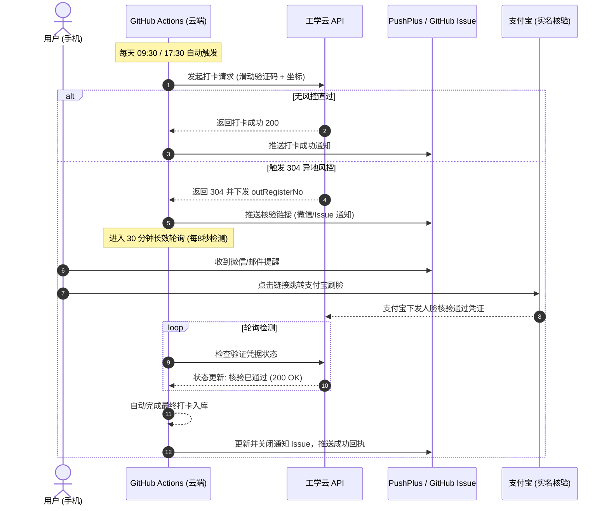

# 🎓 GongXueYunPass - 工学云全自动打卡与周月报提交系统

> 🚀 **全面适配工学云（蘑菇钉）最新 v6.0 API**。支持上下班打卡智能识别、自动补交周报与月报、304 安全风控智能响应闭环、**30 分钟手机刷脸长效轮询**、微信/邮件/GitHub Issue 全渠道联动通知，纯 **GitHub Actions 云端 0 设备全托管**。

---

## 🌟 核心功能特性

- **⚡ 完整支持最新官方接口**：适配工学云/蘑菇钉 `v6.0` 协议，采用 OpenCV 智能算法识别滑动拼图验证码与 AES 加密鉴权。
- **⏰ 智能定时与时间表**：
  - **默认打卡时间**：每天早晨 **09:30**（北京时间）与下午 **17:30**（北京时间）自动触发。
  - 支持在 GitHub Actions 手动调度下拉选择 `START`（上班）或 `END`（下班）按需立即打卡。
- **📝 周报 & 月报全自动提交**：打卡同时自动检测并提交未交的实习周报与月报，省心无忧。
- **🛡️ 304 风控闭环：30 分钟长效轮询 + 手机秒刷直跳**：
  - 针对海外或机房 IP 触发的 304 安全风控，云端自动发起核验并生成支付宝直跳链接；
  - **30 分钟充足等待**：云端后台自动轮询等待长达 **30 分钟**（每 8 秒检测一次），无需担心匆忙超时；
  - **微信直跳 / GitHub Pages 中转**：通过 PushPlus 微信推送或 GitHub Issue 提醒，手机点击链接即可一键拉起支付宝完成人脸核验；
  - **核验即打卡**：手机人脸通过后数秒内，云端自动检测通过、完成签到入库并关闭通知 Issue。
- **📢 多通道消息推送**：支持 PushPlus 微信公众号模板消息、GitHub Issue 邮件提醒、Server酱及自定义 SMTP 邮箱通知。
- **☁️ 纯云端 0 设备依赖**：只需一个 GitHub 账号，无需本地开机、无需常驻软件，安全省电。

---

## 🚀 快速上手部署（GitHub Actions 云端全托管）

### 1. Fork 本仓库并开启 Actions
1. 点击页面右上角 **Fork** 将本仓库复制到你的 GitHub 个人账号；
2. 进入 Fork 后的仓库，点击顶部导航栏的 **Actions**，点击绿色按钮开启工作流（Workflows）。

### 2. 配置 Repository Secrets（核心环境变量）
进入仓库的 **Settings** -> **Secrets and variables** -> **Actions**，点击 **New repository secret** 配置以下变量：

| Secret 键名 | 是否必填 | 说明 | 示例 |
| :--- | :--- | :--- | :--- |
| `PHONE` | **必填** | 工学云登录账号（手机号） | `1788787xxxx` |
| `PASSWORD` | **必填** | 工学云登录密码 | `your_password` |
| `PROVINCE` | **必填** | 打卡所在省份 | `陕西省` |
| `CITY` | **必填** | 打卡所在城市 | `咸阳市` |
| `AREA` | **必填** | 打卡所在区/县 | `兴平市` |
| `ADDRESS` | **必填** | 打卡详细地址描述 | `兴平市xx包装有限公司` |
| `LONGITUDE` | **必填** | 经度（精确到后 6 位） | `108.432481` |
| `LATITUDE` | **必填** | 纬度（精确到后 6 位） | `34.270681` |
| `DESCRIPTION`| 选填 | 打卡备注/签到描述 | `日常实习上班` |
| `PUSHPLUS_TOKEN` | **强烈建议** | PushPlus 微信推送 Token（[pushplus.plus](https://www.pushplus.plus/) 免费获取） | `9a8b7c6d...` |
| `SECRET` | 选填 | Server酱 SendKey 或通知密钥 | `SCT...` |
| `SMTP_PASSWORD` | 选填 | 邮箱授权码（配置后打卡结果邮件直达） | `your_smtp_app_password` |
| `PROXY_URL` | 选填 | 国内 HTTP 代理（用于直连国内 IP 避开 304 风控） | `http://user:pwd@ip:port` |

---

### 3. 打卡与人脸验证流程演示

---

### 4. 手动测试运行
1. 进入仓库的 **Actions** 标签页；
2. 在左侧选择 **`GongXueYun Auto CheckIn & Report`**；
3. 点击右侧 **`Run workflow`**：
   - `sign_type`：可选填 `START`（上班）或 `END`（下班），留空则按当前时间自动判断；
   - `force_checkin`：设为 `true` 可强制执行打卡测试；
4. 点击绿色按钮开始运行，在任务日志中可实时查看运行流程与详细回执。

---

## ❓ 常见问题与排错指南 (FAQ)

### Q1: 收到人脸验证提醒后需要做什么？
- 平台在云端（海外 IP）请求时会触发安全风控，此时 PushPlus 微信端或 GitHub Issue 会立即收到带有跳转按钮的消息；
- 点击链接直接唤起手机支付宝进行人脸识别（或使用手机支付宝扫码）；
- 云端会在 **30 分钟内** 自动保持监听，刷脸完成后数秒内云端即会自动完成打卡，无需电脑介入。

### Q2: 报错 `Connection to api.moguding.net timed out`？
- 工学云接口使用特定的 `9000` 端口。当跨国骨干网络出现偶发抖动时可能出现连接超时；
- 系统已内置重试逻辑，下次定时或手动重新触发即可恢复。如有条件也可在 Secrets 中配置国内代理 `PROXY_URL`。

### Q3: 为什么不需要在本地电脑挂着运行？
- 本项目已针对 GitHub Actions 进行了深度云端适配与风控捕获处理，所有定时调度与异常轮询均在 GitHub 容器内完成，关机不影响定时任务执行。

---

## 📄 免责声明

1. 本项目仅供学习、研究 Python 接口调用、自动化工作流及 GitHub Actions 流程编排使用。
2. 请遵守所在高校与实习单位的相关考勤管理制度，合理合规使用，因违规使用造成的任何后果由使用者本人承担。
3. 本项目严禁用于商业牟利及非法用途。

---

## 🤝 致谢与贡献

- 感谢开源社区对工学云/蘑菇钉 API 协议及加解密算法研究的先驱贡献者。
- 欢迎提交 Issue 与 Pull Request 共同改进！
